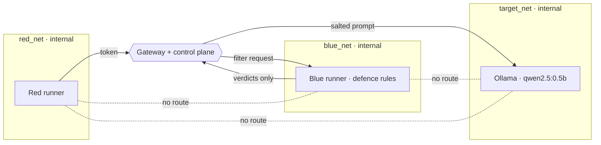

# Bayora

**Isolated infrastructure for adversarial AI safety testing.** Red team, Blue team and the model under test run at the same time on one Docker host, yet Red payloads are not observable by Blue, Blue logic is not inferable by Red, and the model is only reachable through an audited gateway.

Hack in Hills, powered by TinyFish. Problem statement PS-04, team HackHeights.

> Design principle: **communication is allowed; observation is not.**

## Read this first: what is real and what is not

Every result in the console and in this README is either produced by a command you can run, or labelled `SIMULATED`, `MOCK`, `UNAVAILABLE` or `PLANNED`. There are no stored demo numbers: the repo contains **no** attack-success rate, AUC or probe result. You generate them with `pnpm demo`.

* If Docker is down, probes return `UNAVAILABLE` with the reason. They never return pretend results.
* If the model backend fails, the gateway returns `HTTP 502`. There is no silent fallback to a mock.
* The `mock` provider exists for offline development only. Its output is always shown as `MOCK` and is never counted as `MEASURED`.

## Architecture

```
                 host (127.0.0.1 only)
                  :3000 console        :4000 API / gateway
                      |                      |
   edge net ----------+----------------------+
                                             |
                                    +--------+--------+
                                    |     GATEWAY      |  capability tokens, rate limit,
                                    |  + control plane |  concurrency cap, per-tenant cache salt,
                                    |  (Fastify, SQLite)| audit chain, probe runner (docker exec)
                                    +---+----+-----+---+
                       red_net (internal) |    |     | target_net (internal)
                       blue_net (internal)|    |     |
              +-----------+   +-----------+    |  +---------------+
              |    RED    |   |   BLUE    |    |  |  TARGET LLM   |
              | runner    |   | runner +  |    |  |  Ollama       |
              | /payloads |   | /filter   |    |  |  qwen2.5:0.5b |
              +-----------+   | /secrets  |    |  +---------------+
                              +-----------+    |
   RED -x- BLUE      RED/BLUE -x- TARGET directly      RED/BLUE -x- internet
```



* Only the gateway is attached to `red_net`, `blue_net` and `target_net`. All three are Docker `internal: true` networks (no route to the host or the internet).
* Red, Blue and Target run with `cap_drop: ALL`, `no-new-privileges`, read-only root filesystem + tmpfs, non-root users, and pids/memory/CPU limits.
* **Blue's defence rules exist only inside the Blue container image.** The gateway sends Blue the text to check and receives `{blocked, ruleIds}`. Red never learns which stage or rule blocked it, only that it was blocked.
* The Blue defence being on or off for an evaluation pass is a **claim inside the signed capability token**, set by the orchestrator. Red cannot flip it.
* Red payloads and model replies are stored as hashes in the audit chain, not as text.

## Quickstart (Windows, PowerShell, Docker Desktop)

Requirements: Docker Desktop running, Node.js 22.5 or newer, pnpm 10 (`corepack enable`).

```powershell
cd "HackHeights-HIH-main"
pnpm install
pnpm setup                                   # creates .env with random secrets (never committed)

# One-time model download. Only this one-shot container has internet access.
docker compose --profile pull run --rm puller   # pulls qwen2.5:0.5b into a volume; prints PULL_OK

docker compose up -d --build                  # red, blue, target, gateway, web
docker compose ps                             # wait until gateway is "healthy"

pnpm demo                                     # probes, evaluation, side channel, audit, tamper, offline verify
start http://localhost:3000                   # operator console (same data as the demo)
```

Run the checks: `pnpm verify` (install, typecheck, test, build).
Stop: `docker compose down` (add `-v` to also delete volumes, the audit database and the pulled model).

Linux note: set `DOCKER_GID` in `.env` to the group id of `/var/run/docker.sock`. On Docker Desktop leave it at `0`.

If the Ollama container refuses to start with a read-only models volume or root filesystem (this is the least-tested part of the stack), remove `:ro` from the `ollama_models` mount and `read_only` from the `target` service in `docker-compose.yml` and say so in your notes; the probes still cover Red and Blue.

### Development without Docker

```powershell
pnpm setup
# in .env set TARGET_LLM_PROVIDER=mock  (or ollama with a local `ollama serve` and TARGET_LLM_ENDPOINT=http://localhost:11434)
pnpm dev                                      # API on :4000, console on :3000
```

With `mock`, evaluation and side-channel results are labelled `MOCK`/`SIMULATED`, and probes are `UNAVAILABLE`.

## Claims and how to check each one

`VERIFIED(command)` means a command in this repo reproduces the claim and reports pass/fail from real observations. Run it yourself; the README quotes no results.

| # | Claim | Status | Reproduce with |
|---|-------|--------|----------------|
| 1 | Code compiles (API + console) | VERIFIED(`pnpm typecheck && pnpm build`) | same |
| 2 | Red and Blue have no network route to each other, nor to the target, nor to the internet (name and IP tried; DNS tried) | VERIFIED(`pnpm demo`, step 1) | console → Isolation probes |
| 3 | Red/Blue run non-root, CapEff=0, NoNewPrivs=1, read-only rootfs, no Docker socket | VERIFIED(`pnpm demo`, step 1) | same |
| 4 | Red cannot read Blue's secret volume and vice versa; each can read its own (control) | VERIFIED(`pnpm demo`, step 1) | same |
| 5 | Function is preserved: Red and Blue can enrol, call the gateway, and get a completion | VERIFIED(`pnpm demo`, step 1, controls) | same |
| 6 | Blue defence lowers attack success on real prompts, with n, 95% Wilson CI and false-refusal rate | VERIFIED(`pnpm demo`, step 2a) for the chosen model/rules/dataset subset only | console → Evaluation |
| 7 | 502 on model failure, never a silent mock | VERIFIED(`pnpm test`) | `tests/gateway-evaluator.test.ts` |
| 8 | Timing side channel: AUC + bootstrap CI for shared / resource-limited / cache-salted modes from stored samples | VERIFIED(`pnpm demo`, step 2b) as a measurement on one small CPU model. SIMULATED if provider is mock | console → Side-channel |
| 9 | Hash-chained SQLite audit log with Ed25519 checkpoints | VERIFIED(`pnpm demo`, step 3; `pnpm test`) | `GET /api/v1/audit/verify` |
| 10 | Tamper at event N is detected at exactly index N, then restored | VERIFIED(`pnpm demo`, step 3; `pnpm test`) | console → Audit |
| 11 | Exported bundle verifies offline | VERIFIED(`node scripts/verify-bundle.mjs bayora-audit-bundle.json`) | after `pnpm demo` |
| 12 | Signed short-TTL tokens, tenant derived from token only, 401/403/429 paths | VERIFIED(`pnpm test`; live: console → Access control) | `POST /api/v1/access/selftest` |
| 13 | Stable per-tenant HMAC cache salt | VERIFIED(`pnpm test`) | `tests/tokens.test.ts` |
| 14 | Dataset manifest rows carry source, id, license, date; SHA-256 recomputes | VERIFIED(`pnpm test`; `pnpm fetch:datasets` regenerates) | `tests/manifest.test.ts` |
| 15 | gVisor / Kata runtime, Kubernetes NetworkPolicies | **PLANNED**: reference manifests in `infra/`, never applied or tested | n/a |
| 16 | Cross-session contamination experiment (canaries surviving a reset) | **PLANNED**: only an output canary rule exists | n/a |
| 17 | Blue rules are a trained classifier | **No**: they are lexical regular expressions (`runners/blue-rules.json`) | n/a |
| 18 | Cache salting stops KV-cache leakage in general | **Not claimed.** For Ollama the salt is a prompt-prefix marker; whether it helps on your hardware is what experiment 8 measures | n/a |

## Threat model: what is and is not protected

The console page **Threat model** shows this table with live status. Likelihood × impact are the authors' estimates (1–5), labelled ASSESSED.

**Protected (subject to the checks above):** network observation between tenants, direct model access, privilege escalation inside the three containers, cross-tenant file access through volumes, forged/expired/mis-scoped API tokens, silent edits to the audit log, prefix-cache timing between tenants (as measured).

**Not protected:**

* **Shared host kernel.** Containers are not VMs. A kernel or runtime escape defeats everything. gVisor/Kata are PLANNED only.
* **The Docker socket.** The gateway mounts `/var/run/docker.sock` to run probes with `docker exec`. Compromise of the gateway means compromise of the host. Alternative: run the API on the host (`pnpm dev`) and keep only red/blue/target in compose.
* **Blue sees the prompts it filters.** A filter has to. Blue is trusted not to exfiltrate them; Bayora only guarantees Red cannot read Blue's rules and Blue cannot read Red's stored corpus or audit payloads.
* **GPU, power, thermal and scheduler timing channels.** Only TTFT on a CPU model is measured.
* **Single node, single process.** Rate limits and revocations live in memory and reset on restart.
* **Audit signing key shares the data volume with the log.** Someone who can write both can rewrite history. Anchor checkpoints elsewhere (not implemented).
* **Console has no login.** It binds to `127.0.0.1` and holds the admin key server-side. Do not expose it.
* **Refusal detection is a keyword heuristic**, not a judge model, and the Blue rules are simple. Attack-success numbers are specific to the model, rules and prompt subset.

## Datasets (test inputs only)

`data/benchmarks/manifest.json` is committed so the demo works offline. `pnpm fetch:datasets` re-downloads small subsets (20 rows each) and recomputes every SHA-256 from the downloaded text.

| Dataset | Rows | Source | License note |
|---------|------|--------|--------------|
| AdvBench | 20 | github.com/llm-attacks/llm-attacks | MIT |
| HarmBench (standard behaviours) | 20 | github.com/centerforaisafety/HarmBench | MIT |
| JailbreakBench (JBB-Behaviors, harmful) | 20 | huggingface.co/datasets/JailbreakBench/JBB-Behaviors | MIT |
| Jailbreak personas | 20 | huggingface.co/datasets/rubend18/ChatGPT-Jailbreak-Prompts | not stated on the card; check before redistributing |
| Lakera Gandalf (ignore instructions) | 20 | huggingface.co/datasets/Lakera/gandalf_ignore_instructions | MIT |
| Benign set (Stanford Alpaca, instruction-only rows) | 20 | github.com/tatsu-lab/stanford_alpaca | CC-BY-NC-4.0 |

Each row stores: dataset, case id, category, source URL, original row id, license, fetch date, prompt, prompt SHA-256, expected behaviour. NVD/CVE and DARPA Transparent Computing are reference material only and are not used.

## API (admin key via `x-bayora-admin-key`, tenant routes via `Authorization: Bearer <token>`)

| Route | Who |
|-------|-----|
| `GET /health` | public |
| `POST /api/v1/enroll` | Red/Blue runner (enrolment secret decides the tenant) |
| `POST /api/v1/tokens` | admin |
| `POST /v1/chat/completions` (alias `/api/v1/generate`) | tenant token with `model.inference` |
| `GET /api/v1/defense/config` | `defense:read` (Blue, admin); Red gets 403 |
| `GET /api/v1/payloads` | `payloads:read` (Red, admin); Blue gets 403 |
| `GET /api/v1/telemetry`, `/api/v1/anomalies` | tenant token (payloads redacted) or admin |
| `POST /api/v1/probes/run`, `GET /api/v1/probes/latest` | admin |
| `POST /api/v1/evaluations/run`, `GET /api/v1/evaluations[/:id[/rows]]`, `POST /api/v1/evaluations/:id/cancel` | admin |
| `POST /api/v1/side-channel/run`, `GET /api/v1/side-channel/{status,latest}` | admin |
| `GET /api/v1/audit`, `/audit/verify`, `/audit/export`, `POST /audit/tamper-demo` | admin |
| `POST /api/v1/access/selftest`, `GET /api/v1/threat-model`, `GET /api/v1/overview` | admin |

## Repository layout

```
apps/api         Fastify gateway + control plane (TypeScript, node:sqlite)
apps/web         Next.js 15 console (talks to the API through a server-side proxy)
runners/         sandbox-runner.mjs (runs inside red/blue), blue-rules.json (Blue image only)
docker/          red and blue Dockerfiles
docker-compose.yml
data/benchmarks  manifest.json (committed, hash-checked)
scripts/         demo.ts, fetch-datasets.mjs, verify-bundle.mjs, setup-env.mjs
tests/           node:test suites (written to be run by you with `pnpm test`)
infra/           PLANNED reference manifests (k8s NetworkPolicy, gVisor, seccomp): not exercised by compose
legacy/          earlier agent-reliability prototype, kept for reference, not built, not part of the claims
```

## Known limitations

* Results come from a 0.5B-parameter CPU model and small dataset subsets. They show that the pipeline measures things, not that the defence is good.
* Side-channel confidence intervals are wide at the default sample counts; increase `samples` for tighter bounds. "Not detectable at this n" is not proof of no channel.
* The Ollama target is the least-tested container configuration (read-only filesystem, non-root, models mounted read-only).
* Prompt-prefix salting is a PoC stand-in for engines with a native `cache_salt` (for example vLLM).
* This README was written without running the Docker stack end to end; `pnpm demo` is the first full run.
